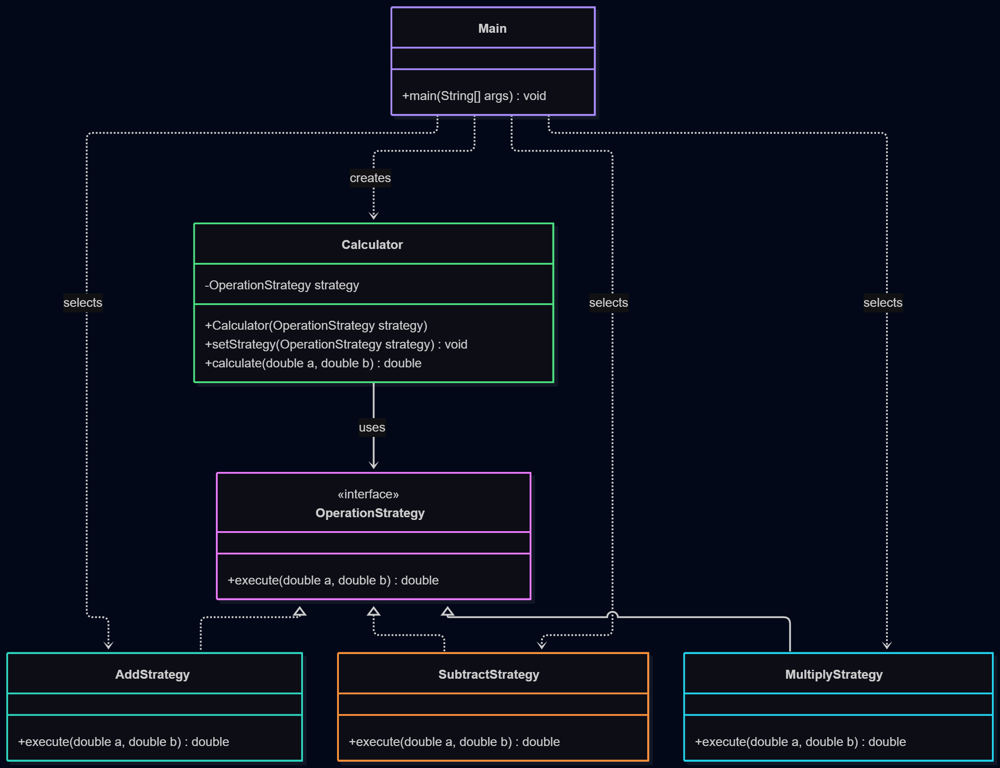

# Assignment 5 — Strategy Pattern

## 1. Introduction

This project demonstrates the Strategy design pattern using a simple calculator.

The calculator supports three interchangeable algorithms: addition, subtraction, and multiplication.

The Strategy pattern allows the calculator to change its behavior at runtime without modifying its internal implementation.

## 2. UML Class Diagram



The OperationStrategy interface defines the common execute() method.

AddStrategy, SubtractStrategy, and MultiplyStrategy implement this interface.

Calculator is the Context, while Main is the Client.

## 3. Clean Code Principles

### 3.1. Replace Conditionals with Polymorphism

Before:
```java
if (operation.equals("add")) {
    return a + b;
} else if (operation.equals("subtract")) {
    return a - b;
}
```

After:
```java
return strategy.execute(a, b);
```

Each operation is implemented in its own class instead of using a long conditional chain.

### 3.2. Meaningful Names

Before:
```java
class A {
    double x(double a, double b) {
        return a + b;
    }
}
```

After:
```java
class AddStrategy implements OperationStrategy {
    public double execute(double a, double b) {
        return a + b;
    }
}
```

Names such as AddStrategy and OperationStrategy clearly describe their purposes.

### 3.3. Single Responsibility Principle

Before: One calculator class contains all mathematical operations and selection logic.

After: Each strategy class is responsible for only one algorithm.

For example:
```java
public double execute(double a, double b) {
    return a * b;
}
```

MultiplyStrategy has only one responsibility: multiplication.

### 3.4. Dependency on Abstractions

Before:
```java
private AddStrategy strategy;
```

After:
```java
private OperationStrategy strategy;
```

Calculator depends on the OperationStrategy interface, not on a specific implementation.

### 3.5. Open/Closed Principle

Before: Adding another operation would require modifying the calculator's conditional logic.

After: A new operation can be introduced by creating another class implementing OperationStrategy.

For example:
```java
public class DivideStrategy implements OperationStrategy {
    @Override
    public double execute(double a, double b) {
        return a / b;
    }
}
```

The Calculator class does not need to change.

## 4. Strategy vs. State

Strategy and State have similar structures, but different purposes.

Strategy is used to select an algorithm explicitly. In this project, the Client chooses whether to add, subtract, or multiply.

State is used when an object's behavior changes depending on its internal state.

Strategy is more suitable because our calculator switches between independent mathematical algorithms.

## 5. Conclusion

The Strategy pattern makes the calculator more flexible and easier to extend. New operations can be added without changing the Calculator class.

Although the pattern introduces more classes, it improves maintainability, readability, and code organization.

## 6. GitHub Repository

Repository URL: https://github.com/IShaymerden/SDP_Assignment5.git
